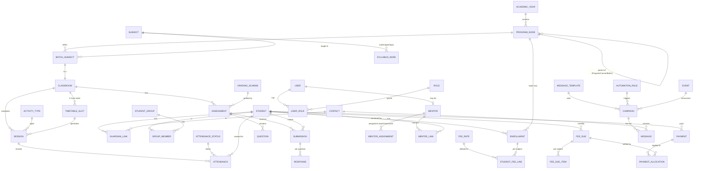

# 03 — Data Model

All tables carry `id (uuid)`, `org_id`, `created_at`, `updated_at`, `archived_at` (soft delete). Configurable/custom data lives in typed `JSONB` columns validated against definitions in the config tables.

## 1. ER diagram (core)

## 2. Entity reference

### Academics
| Table | Key columns |
|---|---|
| `academic_year` | name ("2026-27"), start_date, end_date, is_current |
| `node_type` *(config)* | key (`program`/`course`/`batch`/custom), label, allowed_parent_types[], icon |
| `program_type` *(config)* | key (`school`/`competitive`/`professional`), learner_kind (`minor`/`adult`), guardian_required, profile_field_set, default_billing_model, curriculum_levels (`unit/chapter/topic` or `module/session/topic`), certificate_enabled |
| `program_node` | year_id, parent_id, node_type_id, program_type_id (inherited by children), name, code, **attributes JSONB** (capacity, mode, room, color, start/end date…) |
| `subject` | name, code, board_tags[] (CBSE, ICSE, JEE, NSO…), color |
| `syllabus_node` | subject_id, parent_id, level (unit/chapter/topic), name, weightage, est_hours, order |
| `batch_subject` | batch_id, subject_id, syllabus_version, target_completion_date, default_duration_min (null = inherit from course / activity type) |
| `student_group` | name, kind (`manual`/`rule`), rule JSONB, color |

### Students & contacts
| Table | Key columns |
|---|---|
| `student` | admission_no, first_name, last_name, dob, gender, photo_url, learner_kind (`minor`/`adult`), status, **custom JSONB** (field set chosen by program type) |
| `contact` | name, phone_e164, email, whatsapp_e164, email_opt_in, wa_opt_in, consent_at, consent_source, preferred_channel |
| `guardian_link` | student_id, contact_id, relation (father/mother/guardian/self), is_primary, receives (`all`/`academic`/`fees`) |
| `enrollment` | student_id, batch_id, roll_no, joined_on, left_on, status |
| `group_member` | group_id, student_id, added_by (`user`/`rule`) |
| `field_definition` *(config)* | entity (`student`/`mentor`/`batch`…), key, label, type, options[], required, validation, group, order, visible_to_roles[] |

> The student's own phone/email is also stored as a `contact` with relation `self`, so messaging only ever targets `contact` rows.

### Classrooms & calendar
| Table | Key columns |
|---|---|
| `classroom` | batch_subject_id, name, default_mentor_id, meeting_link |
| `activity_type` *(config)* | key, label, icon, color, default_minutes, takes_attendance, has_submission, is_graded |
| `timetable_slot` | classroom_id, weekday (Mon–Sun), start_time, duration_min, room, mode (offline/online), mentor_id, meeting_link, effective_from, effective_to. **One row per weekly slot**: a subject held 3×/week has 3 rows. Optional `every_n_weeks` for alternate-week classes |
| `session` | classroom_id, slot_id? (null for extras), **kind** (`regular`/`extra`/`makeup`/`rescheduled`), activity_type_id, starts_at, ends_at, status (scheduled/held/cancelled), audience JSONB (whole batch or picked students), reason, **notify_config JSONB** (channels, recipients, template, reminders), topics_covered[], notes, homework, recording_url |
| `schedule_exception` | slot_id, date, action (cancel/reschedule/swap_mentor), new_starts_at, reason, notified_at |
| `calendar_event` | type (`holiday`/`ptm`/`exam`/`event`), title, starts_at, ends_at, audience JSONB, reminders JSONB |
| `resource` | classroom_id?, syllabus_node_id?, title, kind (pdf/link/video), url |

### Attendance
| Table | Key columns |
|---|---|
| `attendance_status` *(config)* | code (P/A/L/E/O), label, color, weight (1/0/0.5), notify_guardian (bool) |
| `attendance` | session_id, student_id, status_id, marked_by, marked_at, remark — **unique(session_id, student_id)** |
| `attendance_policy` *(config)* | scope (global/course/batch), min_percent, window (term/month), action (alert/group) |

### Assessments
| Table | Key columns |
|---|---|
| `grading_scheme` *(config)* | name, kind (`marks`/`percent`/`bands`/`rubric`/`gpa`), bands JSONB `[{min,max,label,points}]` |
| `scoring_scheme` *(config)* | name ("JEE Main"), per-question-type rules JSONB `{mcq:{+4,-1}, integer:{+4,0}, multi:{partial:true}}` |
| `assessment` | classroom_id or batch_id, kind (`assignment`/`test`/`mock`), title, max_marks, due_at, grading_scheme_id, scoring_scheme_id, late_policy JSONB, published_at |
| `question` | assessment_id, number, section, type, correct_answer JSONB, marks, syllabus_node_id |
| `submission` | assessment_id, student_id, status (`pending`/`submitted`/`late`/`missing`/`checked`/`returned`), source (`manual`/`whatsapp`/`email`/`upload_link`), files[], marks, grade_label, remarks, checked_by |
| `response` | submission_id, question_id, answer JSONB, is_correct, marks_awarded |
| `report_card_template` | name, layout JSONB, aggregation rules JSONB |

### Fees & payments
| Table | Key columns |
|---|---|
| `fee_rate` *(config)* | course_id, subject_id (null = bundle), billing_model (`monthly`/`quarterly`/`one_time`/`instalments`/`per_class`), amount, instalment_plan JSONB, effective_from |
| `student_fee_line` | enrollment_id, subject_id, fee_rate_id, **amount** (overridable), discount_type (`percent`/`flat`), discount_value, reason (scholarship/sibling/custom), starts_on, ends_on, status (active/paused/stopped) |
| `fee_due` | student_id, period (`2026-11`) or instalment_no, total, discount, late_fee, due_date, **status** (`not_billed`/`due`/`partial`/`paid`/`overdue`/`waived`), paid_amount, balance |
| `fee_due_item` | fee_due_id, student_fee_line_id, subject_id, amount (after pro-rata/discount), note |
| `payment` | student_id, amount, mode (cash/upi/bank/cheque/gateway), reference, paid_on, receipt_no, received_by, payer (student/guardian/company) |
| `payment_allocation` | payment_id, fee_due_id, amount: one payment can settle several months; advance stays unallocated as credit |
| `fee_adjustment` | student_id, type (charge/waiver/refund), amount, reason, period |
| `fee_policy` *(config)* | scope (global/course), bill_day (1), due_day, grace_days, prorata_rule, late_fee_rule, reminder_schedule JSONB |

> Monthly status grid = `fee_due` pivoted by `student × period`. Unique `(student_id, period)` keeps month generation idempotent.

### Mentors & access
| Table | Key columns |
|---|---|
| `user` | email, password_hash, name, totp_secret, status |
| `role` | name, permissions[] (e.g. `attendance.mark`), is_system |
| `user_role` | user_id, role_id, **scope JSONB** (`{batches:[…]}` / `{mentees:true}` / `{all:true}`) |
| `mentor` | user_id?, name, subjects[], qualifications, **custom JSONB** |
| `mentor_assignment` | mentor_id, target_type (batch/classroom), target_id, role_label |
| `mentee_link` | mentor_id, student_id, since, goals JSONB |
| `mentor_note` | mentor_id, student_id, body, visibility (`private`/`owner`), meeting_at |

### Communication & automation
| Table | Key columns |
|---|---|
| `channel_account` | kind (email/whatsapp), provider (ses/smtp/meta/gupshup), credentials (encrypted), sender_id, is_default |
| `message_template` | name, category (announcement/result/reminder/attendance/fees/event), channel, subject, body (Handlebars), wa_template_name, wa_language, wa_status (approved/pending/rejected), variables[] |
| `campaign` | template_id, audience JSONB, recipient_mode (student/guardian/both), channels[], scheduled_at, status, created_by, trigger (`manual`/`rule:<id>`) |
| `message` | campaign_id, contact_id, student_id, channel, rendered_body, provider_msg_id, status (queued/sent/delivered/read/failed), error, timestamps |
| `inbound_message` | channel, from, contact_id?, student_id?, body, media[], linked_type (submission/doubt/reply), linked_id |
| `automation_rule` | name, event_key, conditions JSONB, actions JSONB, delay, is_enabled |
| `domain_event` (outbox) | key, payload JSONB, occurred_at, processed_at |

### Class notes
| Table | Key columns |
|---|---|
| `session_log` | session_id (unique), summary, topics_covered[] (syllabus_node ids), homework_text, homework_files[], homework_due_at, assessment_id? (if converted to an assignment), resources[], recording_url, logged_by, logged_at, sent_campaign_id |

### Progress reports
| Table | Key columns |
|---|---|
| `progress_report_template` *(config)* | name, program_type, sections[] (attendance/tests/assignments/topics/fees/remark), recipients, channels, generate_day, branding |
| `progress_report` | student_id, period (`2026-10`), template_id, data JSONB (snapshot of the numbers), remark, remark_by, status (`draft`/`approved`/`sent`), pdf_file_id, campaign_id |

### Enquiries
| Table | Key columns |
|---|---|
| `enquiry_stage` *(config)* | key, label, order, is_won, is_lost, color |
| `enquiry` | name, phone_e164, email, guardian_name, interested_course_id, program_type_id, source, stage_id, owner_user_id, next_followup_at, lost_reason, **custom JSONB**, converted_student_id |
| `enquiry_activity` | enquiry_id, type (call/whatsapp/visit/demo/note/stage_change), body, at, by |
| `demo` | enquiry_id, **mode** (`in_class`/`phone`/`video`), session_id? (only for in_class), scheduled_at, duration_min, conducted_by, status (scheduled/done/no_show/cancelled), outcome (interested/thinking/not_interested), notes, logged_manually (bool) |

### Backups
| Table | Key columns |
|---|---|
| `backup_run` | started_at, finished_at, kind (scheduled/manual), destination (gdrive), db_dump_file, excel_file, size_bytes, status, error |

### Platform
| Table | Key columns |
|---|---|
| `setting` | key, value JSONB (institute name, logo, quiet hours, timezone…) |
| `audit_log` | actor_id, action, entity, entity_id, before JSONB, after JSONB, at |
| `file` | storage_key, mime, size, owner_entity, owner_id |

## 3. Key indexes
- `attendance(session_id)`, `attendance(student_id, marked_at)`
- `enrollment(batch_id, status)`, `enrollment(student_id)`
- `session(starts_at)`, `session(classroom_id, starts_at)`, `timetable_slot(classroom_id, weekday)` (calendar + clash checks)
- `fee_due(student_id, period)` unique, `fee_due(status, due_date)` (overdue job)
- `message(campaign_id, status)`, `message(provider_msg_id)` (webhook lookup)
- `contact(phone_e164)`, `contact(whatsapp_e164)`, `contact(email)` (inbound matching)
- GIN on `student.custom`, `program_node.attributes` for filtering on custom fields
